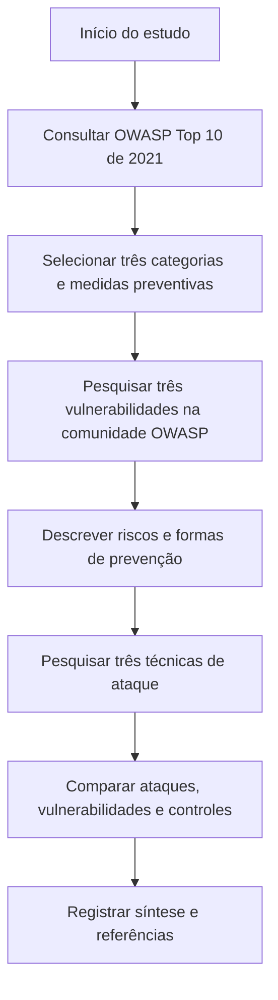

# Investigação do OWASP: riscos e segurança em aplicações web

## Resumo

Este estudo foi desenvolvido a partir do laboratório **Investigação do OWASP**, da Cisco Networking Academy (NetAcad). A proposta é conhecer riscos de segurança em aplicações web, entender como vulnerabilidades podem ser exploradas e identificar medidas de prevenção.

---

## Objetivos de aprendizagem

- Reconhecer riscos comuns de segurança em aplicações web.
- Diferenciar vulnerabilidade, técnica de ataque e impacto possível.
- Identificar controles de acesso e medidas preventivas.
- Relacionar os conceitos à atuação em Suporte de TI, IAM e Cybersecurity.

---

## Parte 1: três categorias do OWASP Top 10 (2021)

| Categoria | Descrição | Prevenção |
|---|---|---|
| **A01:2021 – Broken Access Control** (Falhas no controle de acesso) | O sistema permite acessar dados ou funções sem a autorização necessária. | Aplicar o menor privilégio, verificar permissões no servidor e revisar acessos. |
| **A02:2021 – Cryptographic Failures** (Falhas criptográficas) | Dados sensíveis ficam expostos por ausência ou uso inadequado de proteção criptográfica. | Utilizar HTTPS/TLS, criptografia adequada e proteger as chaves criptográficas. |
| **A07:2021 – Identification and Authentication Failures** (Falhas de identificação e autenticação) | Problemas na verificação da identidade ou no gerenciamento de sessões podem facilitar acessos indevidos. | Adotar MFA, proteger credenciais e sessões e limitar tentativas suspeitas de login. |

**Exemplo:** se uma pessoa consegue visualizar informações de outro usuário apenas alterando um identificador na URL, isso pode indicar uma falha de controle de acesso.

**Conceito importante:** autenticação confirma quem é o usuário; autorização determina o que ele pode acessar.

---

## Parte 2: vulnerabilidades da comunidade OWASP

| Vulnerabilidade | Descrição | Prevenção |
|---|---|---|
| **SQL Injection Vulnerability** | Entradas tratadas de forma insegura podem modificar a estrutura de consultas ao banco de dados. | Usar consultas parametrizadas, tratar entradas e limitar privilégios no banco. |
| **Cross-Site Scripting (XSS)** | Uma aplicação permite que conteúdo não confiável seja interpretado como script no navegador de outros usuários. | Aplicar codificação de saída conforme o contexto, sanitizar HTML quando necessário e usar políticas de segurança de conteúdo como defesa adicional. |
| **Insecure Direct Object Reference (IDOR)** | Falta de verificação de autorização permite acessar objetos ou dados de outros usuários. | Verificar a autorização em cada solicitação e restringir recursos ao usuário autorizado. |

---

## Parte 3: técnicas de ataque

| Ataque | Como funciona | Prevenção |
|---|---|---|
| **SQL Injection** | O atacante tenta inserir conteúdo malicioso para manipular consultas SQL de uma aplicação vulnerável. | Consultas parametrizadas e permissões mínimas no banco de dados. |
| **Cross-Site Scripting (XSS)** | O atacante tenta fazer um navegador executar scripts maliciosos por meio de conteúdo apresentado pela aplicação. | Codificação de saída adequada, tratamento de entradas e controles complementares no navegador. |
| **Brute Force Attack** (Força bruta) | São feitas muitas tentativas para descobrir credenciais ou conseguir autenticação. | MFA, limitação de tentativas e monitoramento de logins suspeitos. |

**Diferença:** vulnerabilidade é uma fraqueza que pode existir no sistema; ataque é a tentativa de explorá-la. A exploração pode ou não resultar em impacto.

---

## Fluxograma do processo de estudo

---

## Aprendizados e aplicação prática

O estudo ajuda a compreender que a segurança de aplicações não depende apenas de senhas ou antivírus. Também exige verificações de autorização, proteção de dados e desenvolvimento seguro.

Na rotina de **Suporte de TI**, esse conhecimento ajuda a reconhecer relatos de acesso indevido e encaminhar incidentes corretamente. Em **IAM**, reforça a importância de permissões adequadas e revisões de acesso. Em **Cybersecurity**, contribui para entender riscos, controles preventivos e a diferença entre uma falha e sua exploração.

---

## Referências

- [OWASP Top 10](https://owasp.org/Top10/)
- [OWASP Top 10:2021](https://owasp.org/Top10/2021/)
- [OWASP Community](https://owasp.org/www-community/)
- [Vulnerabilidades – OWASP Community](https://owasp.org/www-community/vulnerabilities/)
- [Ataques – OWASP Community](https://owasp.org/www-community/attacks/)
- Cisco Networking Academy, *Laboratório - Investigação do OWASP*

